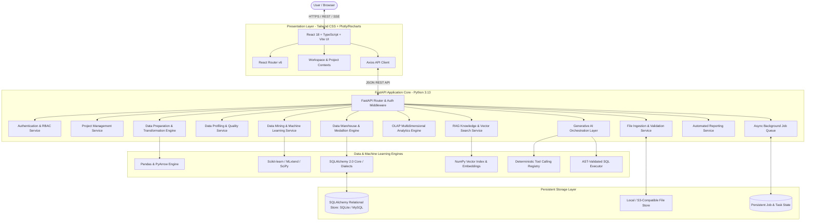
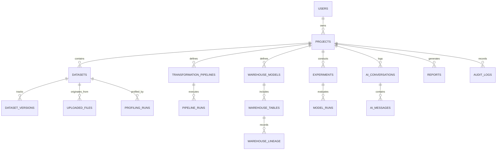

# MarketMine AI — System Architecture Specification

## 1. High-Level Architecture Overview

MarketMine AI employs a decoupled, modular service-oriented architecture designed for maximum reliability, maintainability, and horizontal extensibility.



---

## 2. Modular Subsystem Breakdown

### 2.1 Presentation Layer (`frontend/`)
- **Framework**: React 18/19 with TypeScript, bundled with Vite.
- **Styling**: Tailored Tailwind CSS system featuring custom color palettes (deep slate, indigo, cyan, emerald), dark/light mode toggle, glassmorphism cards, and fluid micro-transitions.
- **Interactive Visualizations**: Integrated Plotly.js and Recharts for interactive scatter plots, heatmaps, correlation matrices, box plots, time-series, and OLAP cubes.
- **State & Communication**: Modular React Contexts for Active Workspace, Authentication, Project, and Job Polling; robust Axios API client with automatic token refreshing and error interceptors.

### 2.2 API & Application Core (`backend/app/`)
- **FastAPI Framework**: Fully typed with Pydantic v2 schemas for all request payloads and responses.
- **Authentication**: JWT bearer token authentication, secure password hashing using `bcrypt`, role-based access control (Admin, Analyst, Viewer), and strict project-level isolation.
- **Modular Routers**:
  - `/api/v1/auth`: Registration, login, profile, token refresh.
  - `/api/v1/projects`: Project CRUD, settings, metadata, activity feeds.
  - `/api/v1/ingestion`: Upload, preview, schema detection, import commit.
  - `/api/v1/datasets`: Dataset exploration, server-side pagination, sorting, filtering.
  - `/api/v1/profiling`: Deep descriptive statistics, distributions, missingness, quality scores.
  - `/api/v1/cleaning`: Column cleaning, type conversions, outlier handling, deduplication.
  - `/api/v1/transformations`: Reusable ETL pipelines, joins, aggregates, unions.
  - `/api/v1/warehouse`: Schema designer, star schema builder, SCD Type 1 & 2, data marts.
  - `/api/v1/olap`: Multidimensional slicing, dicing, roll-up, drill-down, and pivoting.
  - `/api/v1/mining`: Association rules (Apriori), clustering (K-Means/DBSCAN), classification, regression, anomaly detection.
  - `/api/v1/ml`: Model training, evaluation, cross-validation, forecasting (ARIMA/Exp. Smoothing).
  - `/api/v1/ai`: Copilot chat, tool calling, automated data analyst, root cause analysis.
  - `/api/v1/rag`: Document ingestion, embeddings, context retrieval, citations.
  - `/api/v1/reports`: Dynamic report generation (PDF, Markdown, CSV).
  - `/api/v1/jobs`: Asynchronous background task status, cancellation, and logs.
  - `/api/v1/health`: Liveness and readiness probes checking DB and storage health.

---

## 3. Database Design & Relational Schema

The relational schema is divided into **Application Metadata Tables** and **Analytical Warehouse Tables**.



### 3.1 Core Entity Definitions
1. **`users`**: `id` (UUID), `email` (Unique), `hashed_password`, `full_name`, `role`, `is_active`, `created_at`, `updated_at`.
2. **`projects`**: `id` (UUID), `owner_id` (FK -> users.id), `name`, `description`, `domain` (E-commerce, Healthcare, Finance, etc.), `created_at`, `updated_at`.
3. **`uploaded_files`**: `id` (UUID), `project_id` (FK), `filename`, `stored_path`, `file_size_bytes`, `mime_type`, `file_hash_sha256`, `status`, `row_count_estimate`, `created_at`.
4. **`datasets`**: `id` (UUID), `project_id` (FK), `name`, `description`, `source_type` (file, warehouse, derived), `storage_location`, `current_version`, `row_count`, `column_count`, `created_at`, `updated_at`.
5. **`dataset_versions`**: `id` (UUID), `dataset_id` (FK), `version_number`, `parent_version_id`, `storage_path`, `row_count`, `column_count`, `schema_json`, `created_at`.
6. **`profiling_runs`**: `id` (UUID), `dataset_id` (FK), `version_id` (FK), `summary_metrics_json`, `column_stats_json`, `quality_score`, `warnings_json`, `created_at`.
7. **`transformation_pipelines`**: `id` (UUID), `project_id` (FK), `name`, `description`, `definition_json` (ordered steps), `created_at`, `updated_at`.
8. **`pipeline_runs`**: `id` (UUID), `pipeline_id` (FK), `source_dataset_id`, `target_dataset_id`, `status`, `rows_in`, `rows_out`, `execution_time_ms`, `error_message`, `created_at`.
9. **`warehouse_models`**: `id` (UUID), `project_id` (FK), `name`, `model_type` (star, snowflake, flat_mart), `grain`, `description`, `created_at`.
10. **`warehouse_tables`**: `id` (UUID), `model_id` (FK), `table_name`, `table_type` (fact, dimension, staging, mart), `scd_type` (0, 1, 2), `columns_metadata_json`, `created_at`.
11. **`warehouse_lineage`**: `id` (UUID), `project_id` (FK), `source_id`, `target_id`, `operation_type`, `transformation_meta_json`, `created_at`.
12. **`experiments`**: `id` (UUID), `project_id` (FK), `dataset_id` (FK), `task_type` (association_rules, clustering, classification, regression, anomaly_detection, forecasting), `name`, `parameters_json`, `status`, `created_at`.
13. **`model_runs`**: `id` (UUID), `experiment_id` (FK), `algorithm`, `metrics_json`, `artifact_path`, `duration_ms`, `created_at`.
14. **`ai_conversations`**: `id` (UUID), `project_id` (FK), `user_id` (FK), `title`, `context_meta_json`, `created_at`, `updated_at`.
15. **`ai_messages`**: `id` (UUID), `conversation_id` (FK), `sender` (user, assistant, tool), `content`, `tool_calls_json`, `tool_results_json`, `metrics_json`, `created_at`.
16. **`reports`**: `id` (UUID), `project_id` (FK), `user_id` (FK), `title`, `report_type`, `format` (markdown, pdf, html), `content`, `metadata_json`, `created_at`.
17. **`audit_logs`**: `id` (UUID), `project_id` (FK), `user_id` (FK), `action`, `resource_type`, `resource_id`, `ip_address`, `details_json`, `created_at`.
18. **`background_jobs`**: `id` (UUID), `project_id` (FK), `job_type`, `status` (pending, running, completed, failed, cancelled), `progress_pct`, `log_output`, `error_details`, `started_at`, `completed_at`.

---

## 4. Data Warehousing Architecture

### 4.1 Medallion Architecture (Bronze -> Silver -> Gold)
1. **Bronze (Raw / Staging)**: Raw ingested files converted into persistent relational staging tables or Parquet partitions. Schema preserved exactly as uploaded.
2. **Silver (Cleaned / Enriched)**: Data cleansed of invalid values, standardized types, parsed timestamps, imputed or flagged nulls, and deduplicated records.
3. **Gold (Curated Facts & Dimensions)**: Dimensional star schemas and specialized data marts tailored for OLAP querying, executive KPIs, and machine learning feature stores.

```
+------------------+      +-------------------+      +---------------------+
|   BRONZE LAYER   | ---> |   SILVER LAYER    | ---> |     GOLD LAYER      |
|  Raw Ingestion   |      | Cleansed/Enriched |      | Facts & Dimensions  |
| Staging Tables   |      | Deduplicated Data |      | Star/Snowflake Mart |
+------------------+      +-------------------+      +---------------------+
```

### 4.2 Star & Snowflake Schema Support
- **Fact Tables**: Measures (e.g., `revenue`, `quantity`, `discount_amount`, `cost`, `duration`), Foreign Keys linking to Dimensions, Grain metadata.
- **Dimension Tables**: Contextual attributes (e.g., `DimCustomer`, `DimProduct`, `DimDate`, `DimRegion`, `DimChannel`).
- **Snowflake Normalization**: Sub-dimension hierarchies (e.g., `DimProduct` -> `DimSubCategory` -> `DimCategory`).

### 4.3 Slowly Changing Dimensions (SCD)
- **SCD Type 1 (Overwrite)**: Immediate in-place update of non-historical attributes (e.g., correcting customer typo).
- **SCD Type 2 (Versioned History)**: Creation of a new record version with attributes:
  - `surrogate_key` (PK)
  - `business_key` (Natural ID)
  - `valid_from` (Timestamp)
  - `valid_to` (Timestamp / NULL for active)
  - `is_current` (Boolean flag)

### 4.4 OLAP Engine Operations
The OLAP query processor allows dynamic multidimensional analysis directly over Gold/Silver tables:
- **Roll-up**: Aggregating data along hierarchy levels (e.g., Day -> Month -> Quarter -> Year).
- **Drill-down**: De-aggregating data to finer grains (e.g., Global -> Country -> Region -> Store).
- **Slice**: Filtering on a single dimension value (e.g., `Region = 'North America'`).
- **Dice**: Filtering on multiple dimension values simultaneously (e.g., `Region IN ('EMEA', 'APAC') AND Year = 2026`).
- **Pivot**: Transposing dimensions across rows and columns to generate cross-tabular views.

---

## 5. Data Mining & Machine Learning Architecture

The analytical laboratory executes real algorithms directly over user datasets:

```
+-------------------------------------------------------------------------+
|                           DATA MINING LAB                               |
+-------------------------------------------------------------------------+
| Association Rules  | Apriori & FP-Growth (Support, Confidence, Lift)    |
| Clustering         | K-Means, DBSCAN, Hierarchical (Elbow, Silhouette)  |
| Classification     | Random Forest, Decision Tree, Logistic Regression  |
| Regression         | Linear Regression, Random Forest Regressor         |
| Anomaly Detection  | Isolation Forest, IQR, Z-Score Thresholds          |
| Time-Series        | ARIMA, Holt-Winters Exponential Smoothing          |
+-------------------------------------------------------------------------+
```

1. **Association Mining**: Formats transaction-item datasets (one-hot or basket list), runs Apriori, computes confidence, lift, leverage, and generates directed graph network data for frontend visualization.
2. **Clustering Engine**: Handles numeric feature scaling (StandardScaler/MinMaxScaler), categorical one-hot encoding, missing value imputation, executes K-Means across k=2..10 to derive Elbow curves and Silhouette coefficients, profiling each cluster's centroid.
3. **Classification & Regression Engine**: Automatic train-test splitting (80/20), stratified sampling, metrics computation (Accuracy, Precision, Recall, F1, ROC-AUC, Confusion Matrix for classification; MAE, MSE, RMSE, R² for regression).
4. **Anomaly Detection**: Evaluates multi-attribute outliers via Isolation Forest with configurable contamination rates, alongside univariate IQR and Z-score methods.
5. **Time-Series Forecasting**: Validates chronological continuity, computes rolling averages, applies seasonal decomposition (Trend, Seasonality, Residual), and fits models with prediction intervals.

---

## 6. Generative AI & Natural Language Query Architecture

### 6.1 Provider-Agnostic LLM Interface
A unified interface supports OpenAI, Anthropic, Gemini, and local Ollama instances via standard REST APIs, governed by environment configurations (`LLM_PROVIDER`, `LLM_API_KEY`, `LLM_MODEL`).

### 6.2 Deterministic Tool Calling Registry
The LLM does **not** perform arithmetic or speculate on metrics. Instead, it translates user intents into structured tool invocations:
- `tool_query_dataset(dataset_id, sql_query)`
- `tool_compute_eda_summary(dataset_id, columns)`
- `tool_run_clustering(dataset_id, features, k)`
- `tool_find_association_rules(dataset_id, item_col, txn_col, min_support)`
- `tool_investigate_root_cause(dataset_id, metric, dimension, date_col, baseline_period, target_period)`
- `tool_forecast_series(dataset_id, date_col, value_col, horizon)`

### 6.3 Secure AST-Validated NL-to-SQL Engine
When natural language queries require SQL:
1. Schema information (table names, column types, foreign keys) is fed to the query generator with strict prompts.
2. The generated SQL string is parsed into an Abstract Syntax Tree (AST) using SQLGlot or Regex/AST tokenizers.
3. **Security Validation Rules**:
   - Must begin with `SELECT` (or `WITH` CTE leading to `SELECT`).
   - Forbids `INSERT`, `UPDATE`, `DELETE`, `DROP`, `ALTER`, `CREATE`, `TRUNCATE`, `EXEC`, `UNION ALL SELECT ... FROM sqlite_master`, etc.
   - Enforces table access control: Query may only reference tables belonging to the active project.
   - Restricts execution timeouts (default: 10 seconds).
   - Injects mandatory `LIMIT` clauses (maximum: 1,000 rows).
4. Execution occurs in a read-only transaction.

### 6.4 RAG (Retrieval-Augmented Generation) Architecture
- **Document Store**: Ingests project data dictionaries, analytical notes, and business definitions.
- **Chunking & Vectorization**: Fixed-size text chunking with overlap; vectorized via lightweight embeddings.
- **Search & Attribution**: Cosine similarity retrieval returns top-k relevant snippets, appended to the prompt with exact document metadata citations.

---

## 7. Security, Authorization & Governance Model

1. **Authentication**: JWT tokens (HMAC-SHA256) signed with server secret; passwords hashed using `bcrypt` (12 rounds).
2. **Authorization & Multi-Tenancy**: Every database query on project assets contains a mandatory `project_id` and ownership filter. Changing request URLs or IDs returns `403 Forbidden` or `404 Not Found`.
3. **File Safety**:
   - Strict MIME and extension validation (disallows `.exe`, `.py`, `.sh`, `.bat`, etc.).
   - File size caps (default 50MB per file, configurable).
   - SHA-256 integrity checksum verification.
   - Stored in a randomized UUID-keyed storage directory outside web root.
4. **Audit Logging**: Every sensitive action (import, deletion, pipeline execution, SQL query, user login) generates an immutable record in `audit_logs`.
